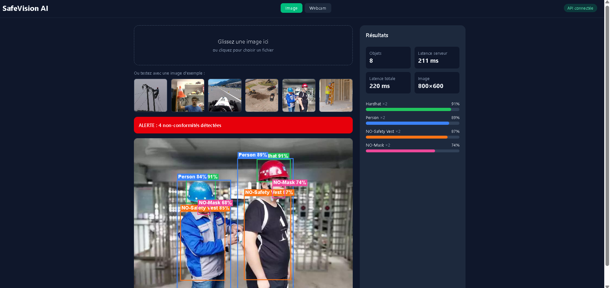

# SafeVision AI

Détection automatique des équipements de protection individuelle (EPI) sur chantier, en temps réel.
Projet de module *Deep Learning Avancé* (Axe 3 : détection d'objets), cycle ingénieur IA & Data Science.

Une image ou un flux webcam est envoyé à une API FastAPI. Un modèle YOLOv8 (exporté en ONNX) détecte les
personnes et les équipements de sécurité. L'interface React dessine les boîtes, affiche les scores et
déclenche une **alerte** quand un équipement manque (classes `NO-…`).


## Classes détectées

`Person`, `Hardhat`, `NO-Hardhat`, `Safety Vest`, `NO-Safety Vest`, `Mask`, `NO-Mask`, `Gloves`, `Safety Cone`

Les classes `NO-…` signalent un équipement **manquant** : ce sont elles qui déclenchent l'alerte.

## Résultats

Évaluation sur le **jeu de test** (55 images), jamais utilisé pour choisir le modèle.

| Modèle | mAP@50 | mAP@[.5:.95] | Précision | Rappel |
|---|---|---|---|---|
| Baseline : YOLOv8n | 0,587 | 0,339 | 0,771 | 0,548 |
| **Avancé : YOLOv8s** (en production) | **0,657** | **0,358** | 0,785 | **0,617** |

Le modèle avancé améliore surtout le mAP@50 et le rappel : il rate moins d'objets. Sa précision
progresse peu.

**Limites connues**

- `Gloves` est quasiment indétectable (rappel 0,07, AP50 0,11) : objets petits et peu nombreux.
- Environ un tiers des `NO-Mask` et `NO-Safety Vest` ne sont pas détectés.
- Le jeu de test ne contient que 55 images : les écarts de quelques points sont dans le bruit.

Détails par classe : `reports/evaluation/per_class.csv`. Matrices de confusion : `reports/evaluation/`.

## Architecture

```
Navigateur ──► Frontend React (nginx, :3000) ──► API FastAPI (:8000) ──► ONNX Runtime (modèle YOLOv8s)
                                                        ▲
                                  DVC (données + modèle)  ·  MLflow (suivi des runs)
```

| Couche | Technologie |
|---|---|
| Modèle | YOLOv8 (Ultralytics), export ONNX, ONNX Runtime |
| API | FastAPI, Pydantic v2, Swagger sur `/docs` |
| Interface | React, Vite, Tailwind CSS |
| MLOps | DVC, MLflow, Docker Compose, GitHub Actions |

### Endpoints de l'API

| Méthode | Route | Rôle |
|---|---|---|
| GET | `/health` | État du serveur, GPU, modèle chargé |
| GET | `/model/metadata` | Nom, architecture, métriques et classes du modèle |
| POST | `/predict` | Image → détections en JSON (boîtes, classes, scores, latence) |
| POST | `/predict/visualize` | Image → image annotée (JPEG) |

Erreurs : `400` si le fichier n'est pas une image valide, `503` si le modèle n'est pas chargé.

## Démarrage rapide (Docker)

Prérequis : Docker Desktop, Git, Python 3.11 (pour DVC).

```bash
git clone <URL_DU_DEPOT>
cd safevision-ai

# 1. Récupérer le modèle (non versionné dans Git)
pip install dvc dvc-gdrive
dvc pull models

# 2. Lancer toute l'application
docker compose up --build
```

- Interface : http://localhost:3000
- API et Swagger : http://localhost:8000/docs

Pour changer le port de l'API, créer un fichier `.env` contenant `API_PORT=8001`.

## Développement local

**Backend**

```bash
cd backend
pip install -r requirements.txt
uvicorn app.main:app --reload --port 8000
```

**Frontend**

```bash
cd frontend
npm install
npm run dev
```

## Tests et qualité

```bash
# Backend : 14 tests unitaires (mock) + tests d'intégration (vrai modèle ONNX)
cd backend
pytest

# Linting
black --check src backend
flake8 src backend
cd ../frontend && npm run lint
```

Ces vérifications tournent automatiquement dans GitHub Actions :

- `.github/workflows/ci-tests.yml` : linting et tests ;
- `.github/workflows/docker-build.yml` : build des images Docker.

## Cycle MLOps

### DVC : données et modèles versionnés

Les données et les poids ne sont jamais committés dans Git, seulement les fichiers `.dvc`.

```bash
dvc pull            # récupère données et modèle
dvc status          # vérifie l'état
```

### MLflow : suivi des expériences

Chaque entraînement journalise ses paramètres, ses métriques et ses artefacts. Le meilleur modèle est
enregistré dans le registre.

```bash
mlflow ui           # puis ouvrir http://localhost:5000
```

### Reproduire le pipeline

```bash
python src/data/filter_classes.py        # filtrage des classes
python src/data/split_by_scene.py        # découpage train/val/test par scène (évite les fuites de données)
python src/models/train_baseline.py      # baseline YOLOv8n
python src/models/train_advanced.py      # modèle avancé YOLOv8s
python src/models/evaluate.py            # évaluation validation + test
python src/models/export_onnx.py         # export ONNX
python src/models/benchmark_inference.py # latence PyTorch vs ONNX
python src/models/register_model.py      # enregistrement dans MLflow
```

## Structure du dépôt

```
safevision-ai/
├── .github/workflows/   # CI : tests/linting et build Docker
├── backend/             # API FastAPI (app/, tests/, Dockerfile)
├── frontend/            # Application React (components/, services/, Dockerfile)
├── src/                 # Code Deep Learning et MLOps (data/, models/, utils/)
├── data/                # Données (versionnées avec DVC)
├── models/              # Modèle ONNX / PyTorch (versionnés avec DVC)
├── reports/             # Résultats d'évaluation
└── docker-compose.yml
```

## Données

Jeu de données public *Construction Site Safety* (Roboflow Universe), filtré sur 9 classes et découpé
**par scène** pour éviter qu'une même scène se retrouve à la fois dans l'entraînement et dans le test.

## Auteurs

Projet réalisé dans le cadre du module Deep Learning Avancé, 3ᵉ année du cycle ingénieur IA & Data Science.
<!-- Ajouter les noms des membres du groupe -->
